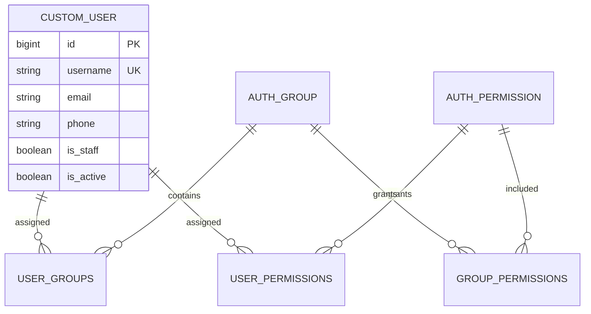

# Comprehensive Software Project Audit — Mounassaba

**Audit date:** 2026-11-08  
**Scope:** Current repository workspace  
**Conclusion:** **NOT READY** — the repository is a small Django backend scaffold, not an operational event-services marketplace.

## Audit method and limits

The audit reviewed the README, dependency manifest, environment example, Django settings, URL configuration, WSGI entry point, app modules, account migration, Git status, and project file inventory. The installed virtual environment was used for safe checks. The ignored `.env` file was detected by its presence but **not read**; no secret values are reproduced here. The existing ignored `backend/db.sqlite3` was queried read-only for table/index metadata only; no row data was inspected. No migrations, seed commands, writes, or destructive operations were run.

The workspace has 26 project files outside the local virtual environment and generated Python caches. No frontend, test suite, CI pipeline, container, deployment manifest, OpenAPI schema, or provider migration exists in the project files. Git reports no commits and all visible project files are untracked, so there is no commit history to audit.

The Django development system check passed. The test command discovered zero tests. The migration dry-run reported no model changes. A production-settings check could not initialize: `DB_PASSWORD` was not supplied by the available configuration; when a temporary placeholder was supplied for diagnosis, Django failed because neither `psycopg` nor `psycopg2` is installed. No production database connection was attempted. A dependency vulnerability scanner was unavailable (`pip-audit` is not installed), so no claim is made that the full dependency set is free of known vulnerabilities.

Evidence labels in this report:

- **Verified:** directly observed in code, runtime checks, or route/database metadata.
- **Not verified:** cannot be concluded from available implementation or environment.
- **Inference:** follows from documented intent plus absent implementation; it is not evidence of an undisclosed running system.

## 1. Executive summary

The README describes a Moroccan event-services marketplace connecting event organizers to photographers, caterers, decorators, DJs, and other providers. The inspected implementation does not provide that marketplace. It contains a Django project configuration, a custom user model with an optional phone field, a single initial migration, and registration of that model in Django Admin. The provider app is empty. Both mounted API URL modules have empty `urlpatterns`; live test-client requests to their base paths returned 404.

There is no frontend despite the README describing React/Vite, no API-based registration or JWT token endpoints despite JWT being configured, no provider/listing/booking domain, and no tests. The local Django setup can perform a system check, but production settings are not runnable with the supplied dependencies/configuration. Django 5.0.14 is installed and allowed by the manifest; the official Django support table marks the 5.0 series unsupported since 2025-04-02. [Django supported versions](https://www.djangoproject.com/download/)

The appropriate classification is **NOT READY**. The code is best understood as a prototype scaffold for an intended product. It is not ready for real customers or production deployment.

## 2. Project overview

| Item | Audit finding |
|---|---|
| Stated purpose | Marketplace for Moroccan event organizers and professional service providers (`README.md:1-3`). |
| Target users | Customers organizing events and service providers are stated in the README. Admin/staff users are implied by Django Admin, but no product roles or journeys are documented. |
| Actual application | Django 5 project with DRF-related packages/settings and a custom Django user model. |
| Actual entry points | `backend/manage.py` defaults to development settings (`:7-18`); `backend/config/wsgi.py` also defaults to development settings (`:1-6`). |
| Actual persistence | SQLite development database at `backend/db.sqlite3`; local schema metadata shows Django auth/admin/session and custom-user tables only. |
| User-facing application | No frontend directory exists. |
| External integrations | None found in source. Email is configured to the console in development (`backend/config/settings/development.py:23-25`). |
| Business flow | No implemented marketplace flow is traceable beyond Django Admin user management. |

## 3. Technology stack

| Technology | Evidence and actual status |
|---|---|
| Python | Python 3.12.5 in the available local venv; README requires Python 3.12+ (`README.md:14-19`). |
| Django | Requirements allow Django `>=5.0,<5.1`; local version is 5.0.14 (`backend/requirements.txt:1`). This series is unsupported as of the audit date. |
| Django REST Framework | Installed/configured (`requirements.txt:2`; `base.py:34-39,140-154`), but there are no API views, serializers, or non-empty API URL patterns. |
| SimpleJWT | Installed/configured for bearer authentication and token lifetimes (`requirements.txt:3`; `base.py:140-165`); token obtain/refresh URLs are absent. |
| django-cors-headers / django-filter | Installed/configured (`requirements.txt:4,9`; `base.py:34-39,51-60,129-154`); no implemented views consume filtering. |
| Pillow | Installed, but no image/file fields or upload endpoints exist (`requirements.txt:5`). |
| python-decouple | Used for environment configuration (`requirements.txt:6`; `base.py:8,18-20`). |
| pytest / pytest-django | Installed (`requirements.txt:7-8`); no project tests were found or run. |
| SQLite | Actual development backend (`development.py:10-15`); local database exists. |
| PostgreSQL | Intended production database (`production.py:12-21`), but PostgreSQL driver is missing from requirements and the local environment. |
| React / Vite / React Router / Axios / Node | Claimed by README (`README.md:9-10,42-51,59-64`); no frontend files or package manifest exist. |
| Build/deploy tools | No Docker, CI/CD, Kubernetes, process manager, or deployment configuration found. |

## 4. Architecture analysis

The code is a minimal, conventional Django layout. Django settings assemble installed apps and middleware, root URLs mount the Admin and two local app URL modules, and the ORM persists the custom user model. The configuration advertises API infrastructure, but no API/business layer is implemented.

```mermaid
flowchart LR
    Browser[Browser / client]
    WSGI[WSGI application<br/>defaults to development settings]
    Django[Django middleware and URL resolver]
    Admin[Django Admin]
    Accounts[/api/accounts/<br/>empty URL patterns]
    Providers[/api/providers/<br/>empty URL patterns]
    SQLite[(SQLite<br/>custom user and Django tables)]
    PostgreSQL[(PostgreSQL<br/>configured for production<br/>driver/config unavailable)]

    Browser --> WSGI --> Django
    Django --> Admin
    Django --> Accounts
    Django --> Providers
    Admin --> SQLite
    WSGI -. production settings require explicit override .-> PostgreSQL
```

### Module map

| Module | Responsibility actually present |
|---|---|
| `backend/config/settings/base.py` | Shared app/middleware setup, environment variables, custom user setting, locale/timezone, DRF/JWT/CORS/filter/pagination defaults. |
| `backend/config/settings/development.py` | SQLite, `DEBUG=True`, console email. |
| `backend/config/settings/production.py` | PostgreSQL settings and a partial set of secure-cookie/header settings; cannot start with currently available driver/config. |
| `backend/config/urls.py` | Admin, accounts prefix, providers prefix, and debug-only media serving. |
| `backend/accounts/` | `CustomUser(AbstractUser)` with optional phone; one migration; registered in Admin. No API or user lifecycle workflow. |
| `backend/providers/` | App registration only; model and URL modules are effectively empty. |
| `backend/manage.py`, `backend/config/wsgi.py` | Management and WSGI entry points, both defaulting to development settings unless environment override is supplied. |

### Execution flow

1. `manage.py` or WSGI selects `config.settings.development` by default.
2. Base settings load Django apps, middleware, environment values, DRF defaults, and the custom user model.
3. Django routes `/admin/` to built-in Admin; `/api/accounts/` and `/api/providers/` include empty route lists; debug mode additionally maps media URLs to Django's development static server.
4. An unauthenticated request to `/admin/` redirects to the login page. Requests to the API prefixes return 404.
5. Admin user actions use Django's ORM and the configured database. No client-side application, marketplace service layer, API serializer, business service, or event/provider persistence follows.

The README's architecture sketch is inconsistent with the workspace: it lists a frontend that is absent. PostgreSQL and JWT are only partly represented by settings/dependencies, not by a runnable production or authentication flow.

## 5. Functional audit

Status uses the requested classifications. "Verified" means an implemented route/behavior was exercised or directly confirmed; a configuration setting alone is not treated as a working feature.

| Functionality | Status | Evidence and reason |
|---|---|---|
| Django Admin sign-in | IMPLEMENTED BUT NOT FULLY VERIFIED | `/admin/` returned 302 for unauthenticated access; actual valid-user login was not exercised. Admin is mounted in `config/urls.py:7-8`. |
| Staff user management in Admin | PARTIALLY IMPLEMENTED | Custom user is registered using built-in `UserAdmin` (`accounts/admin.py:1-8`); no public registration/profile/API flow. |
| JWT login/refresh API | NOT IMPLEMENTED | JWT authentication/lifetimes are configured (`base.py:140-165`), but `accounts/urls.py:1-3` is empty and no token views exist. |
| User roles and authorization policy | PARTIALLY IMPLEMENTED | Django `is_staff`, groups, and permissions are inherited; no marketplace roles, object-level policy, or API permissions are implemented. |
| Provider profiles and provider CRUD | NOT IMPLEMENTED | `providers/models.py` contains only the models import; `providers/urls.py:1-3` is empty; base route returned 404. |
| Provider discovery/search/filter | PARTIALLY IMPLEMENTED | Global DRF filter/search/ordering/pagination defaults exist (`base.py:147-153`), but there is no queryset/view/endpoint to apply them. |
| Event planning, booking, availability, quote/request workflow | NOT IMPLEMENTED | No corresponding model, view, serializer, URL, or UI found. |
| File/image upload or download | NOT IMPLEMENTED | Pillow and media settings exist, but no file field or upload/download business endpoint exists; media serving is debug-only (`config/urls.py:13-14`). |
| Payments, notifications, messaging, reviews, reporting | NOT IMPLEMENTED | No implementation or integration found. |
| Demo data/seed command | NOT IMPLEMENTED | README instructs `python manage.py seed_data` (`README.md:33-37`), but no management command exists. |
| Frontend workflows | NOT IMPLEMENTED | No `frontend/` directory; no UI flows can be inspected. |

The README's advertised marketplace is not operational. A configured button or package does not apply here: the API roots themselves return 404 and there is no provider or booking data model.

## 6. Code quality audit

**Strengths:** The small amount of code is readable, follows standard Django separation, uses Django's built-in auth model rather than rolling password handling, and keeps environment configuration outside source settings. No raw SQL, subprocess use, complex business functions, or obvious duplicate business logic was found.

**Limitations:** There is not enough application code to evaluate modularity, coupling, business-logic placement, scalability, error propagation, or maintainability under real product behavior. The repository has mostly empty apps and no service, serializer, view, API schema, or tests. The `pass` in `CustomUserAdmin` is a deliberate use of Django's default admin, not a defect by itself.

Concrete maintainability concerns:

- Defaults and advertised technologies outpace implementation (`README.md:5-12,42-64`).
- Both entry points default to development settings (`manage.py:7-10`; `config/wsgi.py:1-6`).
- Requirements use version ranges without a lock/constraints file (`requirements.txt:1-9`), and currently permit only the unsupported Django 5.0 series.
- No documented code style, static type checking, linting, CI, or test convention exists.
- The provider app is a placeholder, not a functioning module (`providers/models.py:1`; `providers/urls.py:1-3`).

## 7. Database and data management audit

The inspected SQLite schema contains `accounts_customuser`, its groups and user-permissions join tables, Django auth/group/permission tables, admin log, content types, migrations, and sessions. Django's migration plan reports the built-in migrations and `accounts.0001_initial` as applied. No provider, listing, event, booking, payment, review, or message tables exist. This schema inspection did not read table rows.



| Area | Finding |
|---|---|
| Model/schema | One custom user extending `AbstractUser` with `phone`; inherited username uniqueness and auth relations. No domain entities (`accounts/models.py:1-15`). |
| Migrations | Account initial migration exists. Provider migration directory is absent. `makemigrations --check --dry-run` reported no model changes, which only verifies the currently declared models. |
| Integrity | Django's built-in auth constraints/relations are present. Phone is optional free text (`models.py:7`); no phone normalization, uniqueness, or format rule. No business integrity rules can be checked because domain tables are absent. |
| Indexes/queries | SQLite has standard Django indexes and uniqueness indexes. No custom query code or domain indexes were found; performance and query efficiency are not measurable. |
| Transactions | No marketplace write flow exists, so transaction behavior cannot be evaluated. |
| Production database | PostgreSQL engine configured (`production.py:12-21`) but driver absent, required password absent from the supplied environment example, and no live production DB connection was tested. |
| Backup/recovery | No backup, restore, retention, or recovery procedure is documented or automated. SQLite database file is ignored by Git. |

## 8. API and integration audit

| Method / path | Actual behavior | Auth / response / errors |
|---|---|---|
| `GET /admin/` | Django Admin root | Unauthenticated request returned 302 to login; Admin uses Django session auth. Registered custom-user admin is available after login. |
| Admin subroutes under `/admin/` | Built-in Django Admin routes | Methods and responses are Django-generated; actual authenticated CRUD was not exercised. |
| `GET /api/accounts/` and `/api/accounts/*` | No child routes; base GET returned 404 | No request schema, response contract, auth endpoint, or business error handling. |
| `GET /api/providers/` and `/api/providers/*` | No child routes; base GET returned 404 | No provider API or response contract. |
| `GET /media/*` | Development-only media serving when `DEBUG=True` | No upload API; Django's development serving is not a production file-storage solution. |

The global DRF defaults declare JWT authentication, `IsAuthenticatedOrReadOnly`, filtering/search/ordering, and page-number pagination (`base.py:140-154`). They do not create endpoints. API versioning, schema/docs, throttling/rate limits, endpoint-specific permissions, request validation, and external integration resilience are not implemented. No CORS behavior against a deployed origin could be tested; origins are environment-configured (`base.py:129-135`).

## 9. Cybersecurity audit

This was a source/configuration review, not penetration testing. No external system was contacted. The absence of domain endpoints limits the exploit surface in this workspace, but it also means intended user workflows have no security implementation to assess.

| OWASP/security area | Finding |
|---|---|
| Authentication | Django's built-in password/auth stack backs the custom user and Admin. No public registration, login, password-reset, or JWT token endpoint exists, so those user workflows are absent/unverified. |
| Authorization | DRF's global default is `IsAuthenticatedOrReadOnly`; no API view or object-level policy exists. If views are added without explicit owner/role checks, an authenticated user's write access could be too broad. No active object-level API exploit was demonstrated because there are no API views. |
| Secrets | `SECRET_KEY` is required from environment (`base.py:18`); `.env.example:5` contains a replace-me placeholder. The actual ignored `.env` was not read. There is no code-level check that production is not using the placeholder. |
| Session/CSRF | Django session, CSRF, and clickjacking middleware are enabled (`base.py:51-60`). Production enables secure session/CSRF cookies and `X_FRAME_OPTIONS='DENY'` (`production.py:26-31`). |
| TLS/HSTS | Production settings do not set `SECURE_SSL_REDIRECT` or `SECURE_HSTS_SECONDS` (`production.py:23-31`). A reverse proxy might enforce TLS, but no proxy/deployment configuration proves it. |
| SQL injection | No raw SQL or interpolated query code found. Current database use is Django ORM/Admin. No application-specific query surface exists to test. |
| XSS/CSRF in product UI | No frontend or custom templates exist. Django protections are configured, but a product UI cannot be assessed. |
| CORS | Origin allow-list is environment-configurable; no allow-all setting found. Actual production origin configuration is unknown. |
| File upload/path traversal/SSRF/deserialization | No corresponding application handlers or external fetches found. Pillow/media settings alone do not establish an upload feature. |
| Dependency security | Django 5.0.14 is in an unsupported series; official Django download/support information says 5.0 security support ended 2025-04-02. [Django supported versions](https://www.djangoproject.com/download/). No full dependency advisory scan ran, so other package vulnerability status is unknown. |
| Logging/sensitive data | No custom logging or audit design exists. The ignored `.env` content and database rows were deliberately not inspected or reproduced. |

## 10. Testing and quality assurance report

| Check | Status | Actual result |
|---|---|---|
| `python manage.py check` (development settings) | PASS | `System check identified no issues (0 silenced).` Used an ephemeral placeholder secret in the process environment; no file changed. |
| `python manage.py test --verbosity 2` | NO TESTS | Django found 0 tests, skipped database setup, and reported `NO TESTS RAN`. Exit success is not evidence of test coverage. |
| `python manage.py makemigrations --check --dry-run` | PASS | `No changes detected`; no migration was created or applied. |
| `python manage.py showmigrations --plan` | PASS | Built-in migrations and `accounts.0001_initial` show applied in the existing SQLite database. Read-only plan. |
| Test-client smoke check | PARTIAL | `/api/accounts/` and `/api/providers/` returned 404; `/admin/` returned 302 unauthenticated. No authenticated workflow tested. |
| `check --deploy` in development settings | WARNINGS | Completed with six warnings. This used development settings, including `DEBUG=True`, and a temporary audit key, so it is not a production security verdict. |
| `check --deploy --settings=config.settings.production` | BLOCKED | With no supplied `DB_PASSWORD`, settings loading failed. With a temporary placeholder, loading failed because no PostgreSQL driver was installed. No production DB connection was attempted. |
| Coverage, integration, end-to-end, security, load tests | NOT RUN / NOT AVAILABLE | No project tests, test configuration, frontend, or scanner found; coverage percentage cannot be computed. `pip-audit` is not installed. |

## 11. Frontend and UX audit

No frontend source exists, so visual execution, responsiveness, accessibility, browser compatibility, navigation, form validation, loading/empty/error states, and API state handling are **not assessable**. The README's React 18/Vite/React Router/Axios description is not supported by files in the workspace (`README.md:42-51,59-64`). No UI should be represented as verified.

## 12. DevOps, infrastructure, and deployment audit

| Area | Finding |
|---|---|
| Build/reproduction | Backend requirements exist but no lock file; Node/frontend build cannot be reproduced because the frontend is absent. |
| Settings selection | Both `manage.py` and WSGI default to development settings. A production launcher must explicitly set `DJANGO_SETTINGS_MODULE=config.settings.production`; no deployment config documents or verifies this. |
| PostgreSQL | Production settings require `DB_PASSWORD`, but `.env.example` only documents a commented `DATABASE_URL`, which production settings do not read. The PostgreSQL driver is absent from requirements and venv. |
| Static/media | `STATIC_ROOT` and `MEDIA_ROOT` are set; no static collection, durable object storage, or production media-serving configuration exists. |
| HTTPS/security headers | Secure cookies and frame/content-type settings are partly configured; explicit HTTPS redirect and HSTS are missing. |
| CI/CD/containers | No Dockerfile, Compose, Kubernetes, pipeline, deployment script, health check, or rollback process found. |
| Monitoring/logging | No structured application logs, metrics, traces, alerting, or health/readiness endpoint found. |
| Backups/operations | No database backup, restore, retention, incident response, or recovery evidence found. |

**Deployment verdict:** Local development configuration can initialize and pass Django's system check. A reproducible production deployment is not established and production settings fail with the available dependencies/configuration.

## 13. Performance and scalability

No marketplace request path, workload, deployment topology, or performance test exists, so response time, throughput, memory, concurrency, and scaling behavior cannot be measured. The only database usage visible is ordinary Django auth/Admin. DRF pagination is configured with a page size of 12, but there are no list endpoints to paginate. There is no cache, queue, or asynchronous task infrastructure. No performance number is inferred or invented.

## 14. Documentation and maintainability

The README provides a brief purpose and basic development steps, but it materially overstates the delivered system:

- It lists a React frontend and Node prerequisites although no frontend exists (`README.md:5-19`).
- It instructs developers to run a `seed_data` command that is absent (`README.md:33-37`).
- It advertises JWT authentication and PostgreSQL production (`README.md:57-64`), but API token routes and a runnable PostgreSQL setup are absent.
- It has no working demo account details, API contracts, data model, troubleshooting, deployment, backup, or security documentation (`README.md:53-55`).
- The environment example documents `DATABASE_URL` as optional, while production settings require split `DB_*` variables (`backend/.env.example:9-10`; `production.py:12-20`).

The French README is readable at a high level but does not match implementation. Documentation should be updated only after the product scope and implementation are made consistent.

## 15. Technical debt

Current technical debt is concentrated in unimplemented product scope (empty provider app and absent marketplace entities), API/auth configuration without routes, a production settings path that cannot initialize, unsupported framework constraints, development settings as the default WSGI path, and no tests/CI/operations tooling. The ten findings below give file-level evidence and remediation.

## 16. Identified risks

| Risk | Impact | Related findings |
|---|---|---|
| Product scope is only a scaffold | No customer or provider can complete the advertised marketplace journey. | F-01, F-02 |
| Public API/authentication absent | No customer signup, token login, discovery, or booking workflow; future APIs may inherit overly broad defaults if not scoped. | F-03 |
| Production path is not reproducible | PostgreSQL settings fail before deployment due missing configuration/driver; default WSGI points to development. | F-04, F-05 |
| Unsupported framework baseline | The deployed code would not receive upstream Django security fixes for this release series. | F-06 |
| Security transport policy incomplete | A direct HTTP exposure would permit plaintext traffic; no deployment evidence confirms a proxy enforces TLS. | F-07 |
| No regression safety net | Business behavior cannot be validated and changes can break existing flows without detection. | F-08 |
| No recovery/observability | Incidents, data loss, and outages cannot be managed using documented/automated procedures. | F-09 |
| Misleading setup documentation | Developers may follow commands/stack descriptions that cannot work. | F-10 |
| No commit history in current Git state | Change provenance and reviewability are unavailable in this workspace. | F-11 |

### Findings register

Each finding includes severity, category, evidence, impact, remediation, and an implementation-complexity estimate. Complexity is relative, not a calendar commitment.

#### F-01 — CRITICAL — Functional completeness

- **Description:** The advertised event-services marketplace has no implemented provider, event, booking, availability, quote, messaging, payment, or review capability.
- **Evidence:** README purpose (`README.md:1-3`); empty provider model (`backend/providers/models.py:1`); empty provider routes (`backend/providers/urls.py:1-3`); only custom user in `backend/accounts/models.py:1-15`.
- **Impact:** The product's primary business objective cannot be completed by a user.
- **Recommended action:** Define an end-to-end minimum viable marketplace workflow and implement its domain model, business rules, persistence, and usable journeys.
- **Complexity:** High.

#### F-02 — HIGH — Frontend / documentation mismatch

- **Description:** The README advertises a React/Vite frontend, but no `frontend/` directory or package manifest exists.
- **Evidence:** `README.md:5-12,42-51,59-64`; workspace inventory; `Test-Path frontend` returned false.
- **Impact:** There is no user-facing application to exercise or deploy, and onboarding steps cannot be followed as written.
- **Recommended action:** Build the frontend against a documented API contract, or revise the README to accurately describe the current backend-only scaffold.
- **Complexity:** High to build; low to correct documentation.

#### F-03 — HIGH — API and authentication

- **Description:** API prefixes have empty URL patterns, so the configured JWT stack has no token or business endpoints.
- **Evidence:** `backend/accounts/urls.py:1-3`; `backend/providers/urls.py:1-3`; DRF/JWT config at `backend/config/settings/base.py:140-165`; smoke checks returned 404 for both API roots.
- **Affected component:** Account/provider API routing and global DRF authentication/permission defaults.
- **Exploitation conditions:** No business API is currently available to exploit. This becomes an access-control risk if future mutating views rely on `IsAuthenticatedOrReadOnly` without resource ownership/role checks.
- **Impact:** Customers and providers cannot register, authenticate through the advertised API, or access marketplace data. Future views need explicit role/ownership authorization rather than relying only on global defaults.
- **Recommended action:** Implement versioned serializers/views/routes for the selected workflows, token obtain/refresh and account lifecycle, explicit permissions/object ownership, validation, error contracts, and API documentation.
- **Complexity:** High.

#### F-04 — HIGH — Production database configuration and dependencies

- **Description:** Production settings require `DB_PASSWORD`, while the example documents only a commented `DATABASE_URL`; production does not parse that URL. No PostgreSQL driver is declared or installed.
- **Evidence:** `backend/config/settings/production.py:12-21`; `backend/.env.example:9-10`; `backend/requirements.txt:1-9`; production check failed on missing `DB_PASSWORD`, then on missing `psycopg`/`psycopg2` with a temporary placeholder.
- **Impact:** The documented production configuration cannot start in the audited environment; operators cannot establish reproducible database connectivity from project instructions.
- **Recommended action:** Choose one supported PostgreSQL configuration format, declare/install its driver, document required variables, and verify production startup against a non-production database in CI/staging.
- **Complexity:** Low to medium.

#### F-05 — HIGH — Default WSGI settings select development

- **Description:** WSGI and management entry points default to development settings, where `DEBUG=True` and SQLite are enabled.
- **Evidence:** `backend/config/wsgi.py:5`; `backend/manage.py:7-10`; `backend/config/settings/development.py:10-20`.
- **Affected component:** WSGI/management settings selection.
- **Exploitation conditions:** A production launch that imports the WSGI application without explicitly setting `DJANGO_SETTINGS_MODULE=config.settings.production` will select development behavior. No deployment launcher was present to verify an override.
- **Impact:** A production launcher that does not explicitly override `DJANGO_SETTINGS_MODULE` can run with debug behavior and local SQLite instead of production security/database settings.
- **Recommended action:** Make production settings selection explicit and documented in the deployment entry point; add a deployment check that fails if debug mode or SQLite is used in production.
- **Complexity:** Low.

#### F-06 — HIGH — Unsupported Django release series

- **Description:** The project allows only Django 5.0.x (`>=5.0,<5.1`); local runtime is 5.0.14. The Django support table lists the 5.0 series as unsupported with security support ending 2025-04-02. [Official support table](https://www.djangoproject.com/download/)
- **Affected component:** Django framework runtime and the dependency version range.
- **Exploitation conditions:** The risk applies while a deployed instance runs this unsupported series and a relevant vulnerability exists; this audit did not verify or exploit a specific current CVE.
- **Impact:** The framework series no longer receives upstream security fixes. This is a lifecycle risk; this audit did not establish a specific exploitable vulnerability in the current runtime.
- **Recommended action:** Upgrade to a currently supported Django release, update compatible dependencies, add a lock/constraints strategy, and run migration/regression checks.
- **Complexity:** Medium to high.

#### F-07 — MEDIUM — Production TLS/HSTS not enforced in settings

- **Description:** Production settings enable secure session/CSRF cookies but do not configure HTTPS redirect or HSTS.
- **Evidence:** `backend/config/settings/production.py:23-31`.
- **Affected component:** Production HTTPS/security-header settings and any external TLS termination layer.
- **Exploitation conditions:** A public deployment is reachable over HTTP and no load balancer/reverse proxy redirects or blocks plaintext traffic.
- **Impact:** If the service is directly reachable over HTTP and no upstream proxy enforces HTTPS, credentials and session traffic may be exposed in transit. Whether a proxy exists is not verifiable from this repository.
- **Recommended action:** Establish the trusted TLS termination architecture; enforce HTTPS at the edge and configure Django proxy/security settings and HSTS safely for the production domain.
- **Complexity:** Medium.

#### F-08 — HIGH — No automated tests

- **Description:** The project test command discovers zero tests; no test source files or test configuration exist.
- **Evidence:** `python manage.py test --verbosity 2` output: `Found 0 test(s)` / `NO TESTS RAN`; project inventory.
- **Impact:** No regression evidence exists for authentication, permissions, validation, data integrity, API behavior, or any future business workflow.
- **Recommended action:** Add unit, API integration, permission, migration, and end-to-end tests as workflows are implemented; require them in CI.
- **Complexity:** Medium to high.

#### F-09 — MEDIUM — No operational recovery or observability

- **Description:** No backup/restore, health check, monitoring, structured logging, alerting, or rollback setup is present.
- **Evidence:** Entire project inventory; no deployment/operations files or documentation.
- **Impact:** Production data loss or service incidents would have no verified recovery path and limited diagnosis capability.
- **Recommended action:** Define backup/restore objectives, health/readiness checks, structured logs/metrics, alerting, and a tested rollback procedure before production.
- **Complexity:** Medium to high.

#### F-10 — MEDIUM — README setup steps reference absent features

- **Description:** Documentation instructs users to start React/Vite and run `seed_data`, neither of which exists.
- **Evidence:** `README.md:33-37,42-51`; no frontend or `management/commands/seed_data.py` in inventory.
- **Impact:** A new developer cannot reproduce the documented stack or demo workflow.
- **Recommended action:** Keep setup instructions aligned with files and add a smoke-checked onboarding path.
- **Complexity:** Low.

#### F-11 — LOW — No committed project history

- **Description:** Git reports “No commits yet” and all visible project files are untracked.
- **Evidence:** `git status --short --branch` at audit time.
- **Impact:** The current workspace does not provide a reviewable change history or release baseline.
- **Recommended action:** Establish a reviewed initial commit and normal branch/release controls when the repository is ready for team development.
- **Complexity:** Low.

## 17. Critical findings

1. **The business product is absent (F-01):** marketplace workflows and entities are not present.
2. **There is no user-facing frontend (F-02).**
3. **The API and JWT login flow do not exist (F-03); the API prefixes return 404.**
4. **The production database path fails with current dependencies/configuration (F-04).**
5. **Django 5.0 is unsupported (F-06).**
6. **No tests ran (F-08); no quality gate exists.**

## 18. Recommendations

Resolve readiness blockers in this order: establish MVP scope and access rules; upgrade the unsupported runtime; make the production configuration reproducible; implement and test a complete customer/provider vertical slice; then add UX, CI, security controls, and operations.

## 19. Prioritized improvement roadmap

| Priority | Improvement | Why / completion evidence | Complexity |
|---|---|---|---|
| P0 | Confirm MVP scope and define user journeys for customer, provider, and staff roles. | Accepted journeys, business rules, authorization matrix, and data ownership are documented. | Medium |
| P0 | Upgrade Django and validate dependency compatibility; lock the resolved runtime. | Supported framework release, clean install, checks, and migration/regression suite pass. | Medium-high |
| P0 | Make production settings deterministic: PostgreSQL driver/variables, settings selection, allowed hosts, secure transport, secrets, and static/media handling. | Fresh staging environment starts with debug off and passes deployment checks. | Medium |
| P0 | Implement the first complete vertical slice: account registration/login, provider profile/listing, discovery, and booking/request flow. | Customer and provider can complete the agreed journey through UI/API and persisted data. | High |
| P1 | Add domain constraints, relationships, transactional booking rules, and indexed search fields with migrations. | Invariants are enforced by database/application and tested under concurrent requests. | High |
| P1 | Build the frontend, accessible forms/navigation, responsive states, and API integration. | Main workflows are usable at supported viewport sizes with success/empty/error feedback. | High |
| P1 | Create automated unit/API/permission/functional tests and CI gates. | Test suite exercises positive, negative, boundary, and authorization cases with measurable coverage. | Medium-high |
| P1 | Add API schema/versioning, consistent errors, pagination/filter contracts, throttling, and CORS deployment policy. | Generated API documentation matches tested endpoint behavior. | Medium |
| P1 | Add backup/restore, structured logs, health checks, monitoring, and rollback runbooks. | Restore and rollback drills are recorded; alerts detect unhealthy service. | Medium-high |
| P2 | Add dependency advisory scanning and periodic upgrade process. | CI reports current advisories and blocks/triages high-risk dependencies. | Low-medium |

## 20. Final software maturity assessment

**Classification: NOT READY.** It is not yet functionally operational as the marketplace described in the README. A prototype scaffold is present, but even the primary product journey is absent; calling it "functionally operational" or "production ready" would exceed the evidence.

### Scores

Scores measure **verified readiness in this workspace**, not the potential of Django or the presumed quality of code that is not present. A zero means no assessable implementation/evidence for that dimension, not proof that an absent implementation would perform badly. Performance and UX are scored conservatively because no product path exists to measure.

| Dimension | Score / 100 | Rationale |
|---|---:|---|
| Functional completeness | 2 | Custom user/admin scaffold only; marketplace flows absent. |
| Architecture quality | 22 | Standard Django layout and separated settings, but no implemented product layers and development defaults are used by entry points. |
| Code quality | 38 | Small readable codebase with little risky custom logic; insufficient implementation to demonstrate product quality. |
| Database quality | 20 | Django auth schema/migration works; no marketplace schema, production DB driver, backup, or domain integrity rules. |
| API quality | 3 | DRF configuration exists, but no business endpoints, request/response contracts, or docs. |
| Security | 20 | Django protections are configured, but framework series is unsupported, production transport policy is incomplete, and no product authorization flow exists. |
| Testing maturity | 0 | Zero project tests discovered; no test suite or coverage evidence. |
| User experience | 0 | No frontend exists to assess. |
| DevOps maturity | 8 | Environment examples and split settings exist, but production setup fails and operational automation is absent. |
| Performance | 10 | No workload or product path was measured; no caching/async/scaling evidence. |
| Documentation | 25 | README states purpose and basic setup but documents absent components/commands and omits operations/API detail. |
| Maintainability | 24 | Code is small/readable, but no tests, lock, CI, API contract, or committed history. |

### Overall score methodology

Overall score is a weighted sum, emphasizing shipped functionality and security while still accounting for engineering, operations, and maintainability. The weights sum to 100%.

| Dimension | Weight | Score |
|---|---:|---:|
| Functional completeness | 25% | 2 |
| Architecture quality | 10% | 22 |
| Code quality | 10% | 38 |
| Database quality | 8% | 20 |
| API quality | 8% | 3 |
| Security | 12% | 20 |
| Testing maturity | 8% | 0 |
| User experience | 5% | 0 |
| DevOps maturity | 5% | 8 |
| Performance | 2% | 10 |
| Documentation | 3% | 25 |
| Maintainability | 4% | 24 |

**Weighted overall: 13.05 / 100 (13 / 100 rounded).** The result is low because the main marketed functionality and frontend are missing, tests are absent, and the production path is not runnable. A successful local Django check is evidence only that the scaffold's development configuration initializes.

### Explicit answers to the audit questions

1. **Does the software actually work?** The Django development scaffold initializes and passes its system check. The advertised marketplace does not work because its core flows are absent; API roots return 404.
2. **Are all advertised functionalities implemented?** No. The frontend, seed data, JWT token routes, provider marketplace, and production database setup are missing or incomplete.
3. **Is the architecture technically sound?** The basic Django package structure is conventional, but there is no implemented business architecture to validate, and default entry points select development settings.
4. **Is the code maintainable?** The small existing code is readable, but maintainability of a real product is unproven; there are no tests, CI, lock file, API contract, or domain layers.
5. **Is the database correctly designed?** The custom-user schema is a valid Django auth extension. The marketplace database is not designed or implemented; production PostgreSQL cannot initialize with supplied dependencies/configuration.
6. **Is the application secure?** Django security middleware and some production cookie settings are present. Overall security is insufficiently evidenced; the Django series is unsupported, production HTTPS/HSTS is not enforced here, and domain authorization does not exist.
7. **Are the tests sufficient?** No. The test runner found zero tests; coverage is unknown and no percentage is claimed.
8. **Can the application be deployed?** Development can run; production deployment is not verified and currently fails settings initialization due to missing DB configuration/driver. No deployment automation exists.
9. **Is it ready for real users?** No. It is not ready for customer or provider use.
10. **What are the 10 most important improvements?** (1) Define MVP journeys and roles. (2) Upgrade Django to a supported release. (3) Fix production DB/dependency/settings configuration. (4) Implement the account/auth API and explicit authorization. (5) Implement provider profiles/listings/search. (6) Implement event/booking workflows and database constraints. (7) Build the React frontend or correct product documentation. (8) Add meaningful automated tests and CI. (9) Enforce HTTPS/secrets/host/security policy. (10) Add deployment, backups, monitoring, and recovery procedures.

---

**Audit boundary:** This report describes evidence in the supplied workspace and safe local checks only. It does not claim the absence of separate services or code outside the workspace, does not inspect personal database rows or `.env` contents, and does not claim a full vulnerability scan, authenticated user acceptance test, production deployment, or load test.
