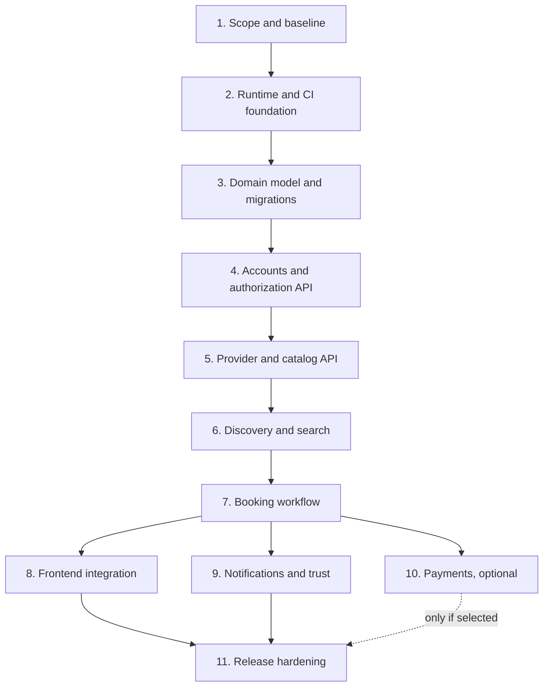

# Mounassaba Implementation Roadmap

**Created:** 2026-11-08  
**Status:** Phase 1 planning deliverable prepared; product-scope assumptions await owner approval.  
**Basis:** `COMPREHENSIVE_SOFTWARE_AUDIT.md` and a fresh workspace inventory.

## Goal

Deliver an operational Moroccan event-services marketplace for customers and professional providers. The outcome must support real user journeys, preserve existing account data and migrations, provide tested API and frontend behavior, and have a reproducible, secure production deployment. Passing Django checks alone is not a completion criterion.

## Current baseline

- Existing implementation is a Django 5 project with a `CustomUser` extending Django `AbstractUser`, one initial account migration, Django Admin registration, and separate development/production settings.
- DRF, SimpleJWT, CORS, and filtering are configured, but no product views, serializers, token routes, or non-empty API routes exist.
- The provider app has no model or migration. No frontend directory exists.
- The development SQLite database exists and has applied Django and account migrations. Its rows were not inspected during the audit.
- Production settings do not initialize in the audited environment: PostgreSQL driver and required database configuration are missing. WSGI defaults to development settings.
- `manage.py test` discovered zero tests. The installed Django 5.0 series is unsupported.
- The Git repository has no commits; current project files are untracked. Preserve the current workspace as the baseline and do not reset or clean it.

Detailed evidence and exact source locations remain in the audit report. This roadmap does not overwrite the audit or existing project files.

## Working rules for every phase

1. **Preserve the current implementation.** Keep `CustomUser` and its applied migration as the account foundation unless a proven requirement forces a change. Do not replace the project wholesale.
2. **Keep existing data safe.** Never reset, delete, or migrate the existing SQLite database as a shortcut. Use a separate test database for automated checks. Back up and rehearse additive migrations on a copy before any real database migration.
3. **Make one phase reviewable at a time.** Implement only that phase's agreed scope, run its acceptance checks, update technical documentation, report evidence, then move to the next phase.
4. **Feature completion requires tests.** A feature is not complete because code exists or a development server starts. Require relevant automated tests and a recorded passing result for its acceptance criteria.
5. **Security is continuous.** Every API/UI phase includes authentication, authorization, input/output validation, privacy, and negative/abuse-case tests as applicable.
6. **Keep environment-specific configuration out of source.** Do not copy local credentials into reports, fixtures, commits, or docs. Verify configuration using placeholders or dedicated test settings.
7. **Update docs in the same phase.** Update README/setup instructions, API/architecture docs, environment examples, and operations docs to match the delivered behavior before marking a phase complete.
8. **No production cutover without explicit review.** Local/test migrations and staging verification can be prepared, but production data changes and external service activation require a separate, concrete deployment decision.

## Proposed MVP scope for Phase 1 approval

These are planning assumptions, not implemented requirements. Confirm or change them before the data model and API shape are built.

| Decision | Recommended MVP default | Why it matters |
|---|---|---|
| User roles | Customer, provider, and staff/admin, with provider accounts still able to act as customers only if explicitly supported. | Drives account profile and object-level permissions. |
| Core marketplace flow | Provider creates a profile and service listing; customer searches and sends a booking request; provider accepts or declines; either side can cancel under a documented rule; completed requests can be closed. | Gives the MVP a testable end-to-end business outcome. |
| Booking semantics | Request/approval workflow; no instant booking until provider availability is reliable. | Avoids promising availability without a calendar/locking model. |
| Payments | Defer online payments, payouts, and stored card data from MVP. Track request state only. | Avoids early payment-provider, refund, fraud, and settlement design before the basic marketplace is validated. |
| Provider trust | Manual admin review/approval before a provider or listing is publicly discoverable. | Establishes a safe initial moderation boundary. |
| Location | Start with city/region filters and a provider-entered service area; defer distance/radius calculations. | Keeps the data model simple until geographic requirements are clear. |
| Language/currency | French-first UI, Africa/Casablanca timezone, MAD display; keep text and currency formatting localizable. | Consistent with current project locale and Moroccan target market. Confirm whether Arabic/RTL is needed for launch. |
| Notifications | In-app status visibility first; email notifications only after an email delivery provider and sender configuration are selected. | Prevents claiming reliable delivery from the development console backend. |
| Reviews/chat | Defer free-form messaging and reviews until booking completion and moderation rules are agreed. | Avoids abuse and moderation surfaces in the initial vertical slice. |

### Phase 1 acceptance criteria

- [x] Re-check the current file inventory and preserve the existing source/data baseline.
- [x] Map audit gaps into a dependency-aware implementation sequence.
- [x] Define phase outcomes, acceptance criteria, documentation deliverables, and test expectations.
- [ ] Product owner confirms or edits the proposed MVP defaults above.
- [ ] Product owner approves the roadmap and authorizes Phase 2 work.

**Phase 1 status:** Planning and baseline documentation are prepared. Phase 1 remains open until the MVP defaults and next-phase scope are confirmed. No application source code, database schema, migrations, or local data were changed in preparing this roadmap.

## Phased implementation plan

### Phase 1 — Product scope and preserved baseline (current)

**Expected result:** An agreed MVP definition, implementation boundaries, and a stable understanding of current code/data. This phase avoids architectural code changes.

**Work:** Confirm user roles and primary journeys; confirm payment, moderation, location, language, notification, and review scope; record current app entry points, existing migrations, and local-data preservation constraints. Keep this roadmap as the decision record.

**Acceptance criteria:** All Phase 1 checkboxes above are complete; defaults are accepted or replaced by explicit decisions; project scope has a clear MVP and deferred list; no code/data changes occur.

**Dependencies:** None.

**Documentation:** This roadmap; later update README's scope after the decisions are approved.

### Phase 2 — Runtime foundation and delivery safety

**Expected result:** A reproducible development/test environment and a production settings path that can initialize without relying on development defaults.

**Work:** Select a currently supported Django release after checking compatibility with the existing Django/DRF/SimpleJWT stack; upgrade within the current project structure; add the required PostgreSQL driver; make environment variables explicit and consistent; make production settings selection explicit; fail safely on missing/unsafe production settings; retain SQLite for development; add a separate test database configuration; add CI for install, Django checks, migration consistency, and tests.

**Acceptance criteria:**

- A clean environment installs from declared, reproducible dependencies.
- Django development and production settings can both load with documented values; production check has debug disabled and a PostgreSQL backend/driver available without connecting to the user's local database.
- The existing account model and migration remain intact; no migration is applied to the existing local database.
- CI runs checks and the current test suite against an isolated database.
- Environment examples contain placeholders only and match the settings code.

**Dependencies:** Phase 1 approval. Product models are intentionally out of scope here.

**Documentation:** Installation, environment-variable reference, supported runtime, CI checks, and local/test database behavior.

### Phase 3 — Domain model and additive database migrations

**Expected result:** A reviewed schema for the approved MVP that extends the current account foundation without destructive rewrites.

**Candidate entities (confirm during design):** provider profile, service category, service listing, customer event/request, booking request and status history, and optional provider service-area representation. Add profile relations to the existing `CustomUser`; do not replace `AUTH_USER_MODEL`.

**Work:** Write a concise data model and state-transition specification; identify unique constraints, foreign keys, deletion rules, indexes, and privacy-sensitive fields; implement small additive migrations; test on an empty isolated database and a copy/snapshot of the existing schema; document backup/restore and rollback conditions.

**Acceptance criteria:**

- ER diagram and invariants reviewed before migrations are generated.
- Migrations preserve existing users and existing applied migration history.
- Fresh database migration succeeds; upgrade from a copy of the current schema succeeds without losing account data.
- Constraints reject invalid relationships and duplicate states; model tests cover required and boundary cases.
- Migration SQL/plan and rollback limitations are reviewed; no destructive migration is applied to the existing DB.

**Dependencies:** Phase 2 runtime baseline and approved Phase 1 product scope.

**Documentation:** ER diagram, model/state descriptions, migration and backup procedure.

### Phase 4 — Account lifecycle and authorization API

**Expected result:** Tested customer/provider account lifecycle and explicit access control, reusing Django's existing custom-user foundation.

**Work:** Add API serializers/views/URLs for the approved registration, login/token obtain/refresh, current profile, and profile update flows; add role and ownership rules; decide whether provider role is a profile relation or account role based on Phase 1 decisions; add safe password reset only when an email delivery path is approved; document token lifetimes and revocation behavior.

**Acceptance criteria:**

- API contract includes request/response shape and error/status behavior.
- Tests cover valid/invalid registration, duplicate identity, token obtain/refresh, expired/invalid tokens, inactive users, role escalation, and cross-account access denial.
- Passwords are handled only through Django's password APIs; secrets/tokens are not logged.
- API routes work through the configured DRF stack; unauthenticated and unauthorized behavior is verified.

**Dependencies:** Phases 2 and 3.

**Documentation:** Authentication/API docs, role matrix, environment/email configuration if applicable.

### Phase 5 — Provider onboarding and service catalog API

**Expected result:** Providers can submit profiles/listings and staff can review them; public data exposes only approved records.

**Work:** Implement provider profile and listing CRUD, category references, validation, moderation status, authorization, and any approved image upload workflow. Use storage-safe filenames, size/type checks, and non-executable media storage. Configure pagination and predictable filtering.

**Acceptance criteria:**

- Provider can create/edit only their own profile/listings; customer cannot edit provider data; staff moderation is explicit and audited.
- Unapproved listings are not publicly returned.
- Tests cover validation, ownership, moderation visibility, file constraints, and pagination.
- No database file/media data is written outside the isolated test environment during automated checks.

**Dependencies:** Phases 2-4 and Phase 3 schema.

**Documentation:** Provider onboarding and moderation workflow, catalog API, media configuration.

### Phase 6 — Discovery, search, and location filtering

**Expected result:** Customers can find approved listings through tested and bounded search/filter APIs.

**Work:** Implement text search and approved filters (category, city/region, price range, service availability if supported); define ordering and pagination; add only indexes supported by query plans; prevent unbounded result sets.

**Acceptance criteria:**

- API documentation defines supported filters, ordering, page size, and invalid-filter behavior.
- Tests verify filters compose correctly, exclude unapproved listings, enforce bounds, and preserve authorization/privacy.
- Query-count/performance checks use representative fixtures; no performance claims are made without measured results.

**Dependencies:** Phase 5 catalog data and approved Phase 1 location policy.

**Documentation:** Search contract, supported filters, any indexing decision.

### Phase 7 — Booking request and event workflow

**Expected result:** Customer-to-provider booking requests have a reliable, auditable lifecycle.

**Work:** Implement request submission, provider accept/decline, customer/provider cancellation rules, completion, and status history. Use transactions and database constraints for competing status changes; store event date/location/notes according to approved privacy rules; make notifications an event hook, not an untracked side effect.

**Acceptance criteria:**

- Only authorized parties can view or change a request.
- State transitions are explicitly enumerated; invalid/replayed transitions fail with documented errors.
- Concurrent acceptance/cancellation scenarios are tested against the production database engine in CI/staging.
- Tests cover availability conflicts, duplicate submissions, time zones, past dates, cancellation, and status history.
- No online payment is implied unless separately approved and implemented.

**Dependencies:** Phases 3-6.

**Documentation:** Booking state diagram, cancellation policy, API contracts, operational event records.

### Phase 8 — Frontend foundation and customer/provider journeys

**Expected result:** A usable web client integrated with the completed API flows.

**Work:** Add the missing React/Vite frontend or an explicitly approved alternative; build route/layout structure, API client, auth/session handling, provider onboarding/listing, discovery, booking requests, and staff workflows if staff UI is in scope. Add responsive and accessible form/error/loading/empty states.

**Acceptance criteria:**

- Automated end-to-end tests cover registration/login, provider listing submission/moderation, customer discovery, and booking request status updates.
- API errors and session expiry produce clear UI feedback; loading and empty states exist.
- Keyboard/accessibility checks and responsive viewport checks pass for the agreed browser matrix.
- Frontend build is reproducible from a lock file and does not embed secrets.

**Dependencies:** Stable API contracts from Phases 4-7. UI work may prototype earlier only against agreed contracts and must not be called complete before integration tests pass.

**Documentation:** Frontend setup, route/journey guide, browser support, accessibility notes.

### Phase 9 — Notifications and marketplace trust features

**Expected result:** Users receive reliable status communication, and approved trust features fit the booking lifecycle.

**Work:** Select an email provider/configuration before enabling delivery; implement retry/idempotency and delivery-failure visibility; add in-app notifications if approved. Implement reviews only after completed bookings and moderation rules are defined. Add provider verification controls if included in MVP.

**Acceptance criteria:**

- Notifications are sent only to authorized recipients and contain no secrets or unnecessary sensitive details.
- Duplicate events do not create duplicate user-visible messages; failures can be retried and observed.
- Reviews (if included) are tied to completed bookings, one per eligible participant, and have abuse/moderation rules with tests.
- Provider verification (if included) cannot be self-granted and has audit history.

**Dependencies:** Phases 4, 5, and 7; email provider approval/configuration before live delivery.

**Documentation:** Notification/event behavior, provider verification/review policy, delivery configuration and runbook.

### Phase 10 — Payments (optional, separate approval gate)

**Expected result:** Only if approved, an external payment flow with reconciled transaction states and safe handling of failure/refund cases.

**Work:** First select the payment provider and supported Moroccan payment methods, settlement/payout model, refund/cancellation policy, and ownership of card data. Use provider-hosted/tokenized payment collection; never store raw card credentials. Implement idempotent webhooks and reconciliation only after the provider contract is settled.

**Acceptance criteria:**

- Provider sandbox tests cover success, declines, duplicate/out-of-order webhooks, refund, cancellation, timeout, and reconciliation.
- Secrets are managed outside source; webhook signatures are validated; no raw card data is stored or logged.
- Financial state is auditable and reconciles with provider records.
- Production payment activation has explicit owner approval and a rollback/incident plan.

**Dependencies:** Phase 7 booking lifecycle plus a separate product/provider decision. This phase is not required to launch an inquiry/booking-request MVP if Phase 1 defers payments.

**Documentation:** Payment architecture, supported methods, refund/settlement policy, operations and reconciliation runbook.

### Phase 11 — Release hardening and production readiness

**Expected result:** A deployable service with evidence for security, reliability, recovery, and monitored operation.

**Work:** Run full regression, dependency scanning, security review, performance/load checks against agreed targets, accessibility review, and staging deployment. Add production health/readiness checks, structured logs/metrics, error alerting, rate limits, database backups and restore drills, static/media storage, migrations in release process, and rollback runbook. Resolve high/critical findings before release.

**Acceptance criteria:**

- All functional acceptance suites pass in CI and staging; no feature is marked complete without tests.
- Dependency scanner output is reviewed; high/critical findings have fixes or approved mitigations.
- Django deployment checks pass with real production-shaped settings and debug disabled.
- Load results are reported with workload, environment, and measured values; targets are agreed before testing.
- Backup restore and release rollback have been rehearsed successfully.
- Monitoring and alerts detect a failed health check and representative application/database errors.
- Production release checklist, runbooks, privacy/security documentation, and user-facing setup/support docs match deployed behavior.

**Dependencies:** All production-bound phases; payment phase only if payments are included.

**Documentation:** Deployment/release guide, backup and restore, incident response, monitoring, security and support runbooks.

## Dependency map

**Cross-phase gate:** The roadmap is deliberately sequential even where implementation could overlap. Within each phase, independent unit/API/frontend/operations work may be parallelized only after the phase contract is agreed; the phase does not close until its integration acceptance criteria and documentation are complete.

## Phase completion report template

For each phase, report:

- Scope delivered and files changed.
- Migrations created and how they were tested; confirm whether any real data was touched.
- Commands/tests executed with actual pass/fail/skip results.
- Acceptance criteria met or still open.
- Security/data risks introduced or resolved.
- Documentation updated.
- Next phase dependency and any decision needed.

Never label a feature "complete" if its tests were skipped, absent, or failing. If a test cannot run, record the blocker and keep the feature incomplete.

## Approval gate before Phase 2

Before framework upgrades or architecture/schema work, please confirm:

1. Whether the proposed MVP defaults are acceptable, especially **request-based bookings**, **no online payments in the initial MVP**, and **manual provider/listing approval**.
2. Whether French-first and city/region-based search are appropriate; whether Arabic/RTL or distance-based search is launch scope.
3. Whether this roadmap is approved and Phase 2 (runtime foundation only, no domain-schema changes) may begin.

Until that approval is received, preserve the current app and database and make no significant implementation or architectural changes.
