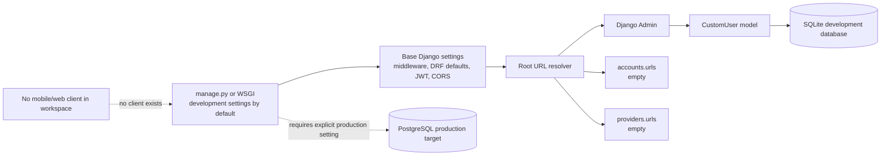
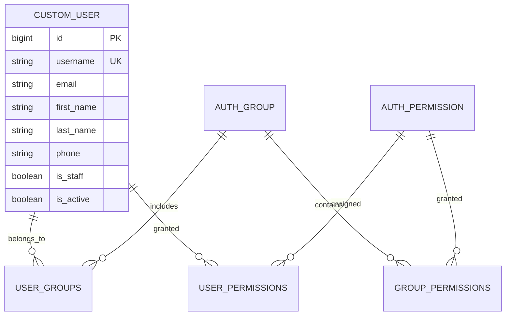

# Mounassaba Architecture Overview — As Found

**Audit date:** 2026-11-08  
**Status:** Repository contains a backend scaffold only. This describes observed implementation, not a proposed future architecture.

## Repository structure

```text
mounassaba/
├── README.md
├── .gitignore
├── backend/
│   ├── manage.py
│   ├── requirements.txt
│   ├── .env.example
│   ├── accounts/
│   │   ├── models.py              # CustomUser(AbstractUser) + phone
│   │   ├── admin.py               # Django UserAdmin registration
│   │   ├── urls.py                # empty urlpatterns
│   │   └── migrations/0001_initial.py
│   ├── providers/
│   │   ├── models.py              # no model
│   │   ├── admin.py               # no registration
│   │   └── urls.py                # empty urlpatterns
│   └── config/
│       ├── urls.py                # admin + empty app prefixes + debug media
│       ├── wsgi.py                # defaults to development settings
│       └── settings/
│           ├── base.py
│           ├── development.py     # SQLite, DEBUG=True
│           └── production.py      # PostgreSQL; driver/config currently missing
└── audit/                         # audit documents created for this pre-production review
```

No Android, iOS, Flutter, React Native, Expo, React/Vite frontend, package manifest, mobile build, or test tree exists. The README says React/Vite is part of the architecture, but source files are absent.

## Component dependency map



## Actual request flow

1. `backend/manage.py` and `backend/config/wsgi.py` default to `config.settings.development` unless the process sets another `DJANGO_SETTINGS_MODULE`.
2. Base settings load Django built-ins, DRF, SimpleJWT, CORS, django-filter, `accounts`, and `providers`; the custom user model is configured.
3. Root URL configuration mounts `/admin/`, `/api/accounts/`, and `/api/providers/`.
4. Django Admin routes to built-in admin pages. The custom user is registered. Anonymous `/admin/` request returned 302.
5. Both app URL modules have empty lists; `/api/accounts/` and `/api/providers/` returned 404.
6. Development uses `backend/db.sqlite3`. Production config targets PostgreSQL, but current environment lacks the driver and matching configured credentials.

There is no mobile-to-backend/API/database data flow to trace.

## Data model discovered



The account model inherits Django auth fields/relations and adds optional `phone` (`backend/accounts/models.py:1-15`). No customer profile, provider profile, category, listing, event, booking, status history, review, notification, or verification model exists. The local schema metadata shows only Django and custom-user tables; no user data was read.

## API and authentication

- DRF is installed. Base settings configure JWT authentication, `IsAuthenticatedOrReadOnly`, search/order/filter backends, and page-number pagination (`backend/config/settings/base.py:140-165`).
- `accounts/urls.py` and `providers/urls.py` each declare an empty URL list.
- No serializer, API view, viewset, token obtain/refresh route, OpenAPI schema, endpoint version, rate limit, or business permission class is present.
- Django Admin uses session auth. It is the only verified non-404 application route.

## Storage and external services

- Development DB: SQLite.
- Production DB intent: PostgreSQL; no driver found and settings fail to initialize.
- Media paths are configured, and the root URL config serves media only in debug mode. No upload model/endpoint/storage provider exists.
- No payment, map/geocoding, push notification, email delivery, analytics, crash reporting, cloud storage, or third-party SDK integration found. Development email uses console backend.

## Missing infrastructure

- Mobile framework/project and app signing/build pipeline.
- Backend API/domain model implementation.
- PostgreSQL driver and reproducible production configuration.
- Test suite, mobile test environment, and CI.
- Docker/deployment manifests, TLS termination evidence, health checks, monitoring, structured logs, backups, restore, and rollback.
- Privacy/data-flow/account-rights documentation and verified CNDP/legal review.

## Architecture review notes

The existing Django package/settings structure is conventional and the custom user model is already selected (`AUTH_USER_MODEL='accounts.CustomUser'`). Preserve that model and existing migration where feasible. The repository does not contain enough product code to assess mobile architecture quality, API scalability, transaction boundaries, or client/backend contract quality. Platform/framework selection must be a documented product/engineering decision before creating the client.
