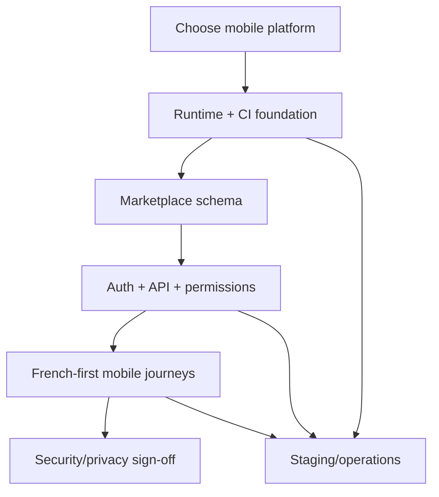

# Mounassaba Technical Remediation Roadmap

**Purpose:** Prioritized work required to move the audited repository toward a verified MVP mobile release. This is an audit recommendation only; no remediation was started.

## P0 — Release blockers

### P0.1 Decide the mobile platform and client architecture

- **Problem:** No mobile project or framework exists; Android/iOS target is unknown.
- **Impact:** No app can be built, tested, or submitted.
- **Proposed solution:** Product/engineering decision on Android, iOS, or both; select native/cross-platform framework using team skills, supported OS matrix, accessibility/localization needs, and release constraints. Document trade-offs before creating the app shell.
- **Affected components:** New mobile workspace, CI, API client, release/signing pipeline.
- **Dependencies:** Product owner approval; no backend schema change required to make the platform decision.
- **Acceptance criteria:** Approved architecture decision record identifies target platforms/framework, supported OS versions, navigation/state strategy, secure token storage approach, localization strategy, and CI/build approach.
- **Required tests:** No feature tests yet; verify a minimal app shell builds reproducibly for each approved platform before moving on.
- **Complexity:** MEDIUM.

### P0.2 Restore a supported backend runtime and valid production configuration

- **Problem:** Django 5.0 is unsupported; production cannot initialize without a PostgreSQL driver and compatible environment config; WSGI defaults to development.
- **Impact:** Security-maintenance and deployment blockers.
- **Proposed solution:** Upgrade to a currently supported Django series after checking DRF/JWT compatibility; add PostgreSQL driver; align settings and environment docs; explicitly select production settings; reject unsafe `DEBUG`, database, host, and secret settings.
- **Affected components:** `backend/requirements.txt`, `backend/config/settings/*`, `backend/config/wsgi.py`, `backend/manage.py`, `.env.example`, CI.
- **Dependencies:** P0.1 is independent; complete before domain migrations and API feature work.
- **Acceptance criteria:** Clean install; development check passes; production checks initialize with isolated test settings and driver installed; no debug/SQLite production; existing account migration remains unchanged.
- **Required tests:** Dependency install/check CI, configuration tests for missing/placeholder settings, isolated PostgreSQL connectivity smoke test; no access to current local DB.
- **Complexity:** MEDIUM-HIGH.

### P0.3 Define and add the approved marketplace schema safely

- **Problem:** Only the custom user exists; no provider/listing/booking data model.
- **Impact:** No marketplace persistence or integrity rules.
- **Proposed solution:** Specify provider profile, service category/listing, request-based booking and status history; constraints, ownership, moderation, city/region, privacy and deletion rules. Keep the existing custom user; use additive migrations.
- **Affected components:** `backend/accounts`, `backend/providers`, new domain app(s), migrations.
- **Dependencies:** MVP scope approval and P0.2.
- **Acceptance criteria:** ER diagram and state model reviewed; fresh DB migrate succeeds; upgrade from a copy of the current schema preserves account data; no migration touches production/current local DB.
- **Required tests:** Model constraints, uniqueness, relations, deletion behavior, migration from empty and copied old schema, booking state invalid transitions.
- **Complexity:** HIGH.

### P0.4 Implement backend authentication, permissions, and MVP API

- **Problem:** Empty account/provider URL modules, no serializers/views/token endpoints, no object permissions.
- **Impact:** Mobile app cannot register, authenticate, discover services, or request bookings securely.
- **Proposed solution:** Implement documented account/token/profile, provider/listing moderation, city/region search, and booking request/status endpoints with explicit role and object ownership controls.
- **Affected components:** Django apps, DRF serializers/views/URLs/permissions, database, API schema.
- **Dependencies:** P0.2 and P0.3.
- **Acceptance criteria:** API contract covers statuses/errors/pagination; providers/listings hidden until approved; only booking parties/staff can access or transition a booking; business state transitions are transactional.
- **Required tests:** Registration/token/expiry, role escalation, cross-user access, moderation, listing visibility/search, duplicate/concurrent booking requests, invalid transition, cancellation and error handling.
- **Complexity:** HIGH.

### P0.5 Deliver the customer and provider mobile MVP journeys

- **Problem:** No client UI or integration exists.
- **Impact:** Real users have no interface for the marketplace.
- **Proposed solution:** Implement French-first account flows, provider profile/listing submission, customer city/region search/profile, booking request, provider accept/reject, status tracking, and staff/admin moderation surface (mobile admin only if explicitly selected; web admin may remain).
- **Affected components:** New mobile app, API client, localization, upload, navigation/state, backend APIs.
- **Dependencies:** P0.1, P0.4; API contracts may be finalized before all UI work.
- **Acceptance criteria:** End-to-end request-based customer/provider journeys work against test/staging backend; no payment workflow implied; manual approval enforced.
- **Required tests:** Unit/widget/component tests, API integration, end-to-end, session expiry/navigation, network loss/retry, image validation if upload included, accessibility and locale formatting.
- **Complexity:** HIGH.

### P0.6 Close privacy and security release gates

- **Problem:** No privacy notice, lifecycle/deletion process, processing map, transfer/processor evidence, or mobile security implementation exists.
- **Impact:** Personal data may be collected without verified controls; mobile data exposure unknown.
- **Proposed solution:** Map data purposes/recipients/hosting/retention; minimize collection; document user notice and rights; review CNDP formalities/transfers with qualified counsel; implement secure token storage, TLS, secrets, rate limits, secure uploads, and log redaction.
- **Affected components:** Mobile app, API, settings, deployment, legal/privacy documentation.
- **Dependencies:** P0.1, P0.4, and actual vendor/hosting selection.
- **Acceptance criteria:** Threat model, privacy/data-flow record, approved disclosures, secrets and transport verified, no high/critical security findings left open.
- **Required tests:** Auth/authorization abuse cases, file validation, token storage inspection, release binary secret scan, dependency scan, privacy-flow review; legal/CNDP review recorded separately from technical test results.
- **Complexity:** HIGH.

## P1 — High priority after MVP flows exist

### P1.1 Establish continuous test/build/release CI

- **Problem:** No project tests or CI; a zero-test command currently exits without behavioral assurance.
- **Solution:** Backend test suite plus mobile lint/unit/build pipelines; isolated databases and artifact retention.
- **Dependencies:** P0.1-P0.5.
- **Acceptance criteria:** Required tests block merges; release artifacts build reproducibly; test reports distinguish pass/fail/skip.
- **Tests:** CI pipeline itself, clean dependency install, test DB, Android/iOS build matrix as applicable.
- **Complexity:** MEDIUM.

### P1.2 Complete media, notification, and moderation operations

- **Problem:** Pillow/media settings exist without secure upload/storage; no notification provider or moderation audit trail.
- **Solution:** Add bounded image processing and controlled storage; choose email provider before sending; implement notification retries/idempotency and admin audit history.
- **Dependencies:** P0.3-P0.5; external provider selection for email.
- **Acceptance criteria:** Only authorized access, validated files, observable delivery failures, and auditable admin decisions.
- **Tests:** Invalid MIME/size, unauthorized access, duplicate event delivery, retry/failure, moderation audit.
- **Complexity:** MEDIUM-HIGH.

### P1.3 Add production operations and recovery

- **Problem:** No monitoring, backup/restore, health checks, rollback, or deployment evidence.
- **Solution:** Staging and production deployment runbooks, health/readiness probes, structured logs/metrics, backup/restore drills, migration/rollback practice.
- **Dependencies:** P0.2-P0.6.
- **Acceptance criteria:** A staging release and restore/rollback rehearsal succeed; incident signals are observable.
- **Tests:** Health check failure, DB outage behavior, restore drill, rollback procedure.
- **Complexity:** MEDIUM-HIGH.

## P2 — Important quality improvements

- Optimize search and image behavior based on measured representative workloads; add indexes/caching only from profiling evidence.
- Add deeper accessibility and supported-device testing; verify dynamic text scaling, screen-reader semantics, focus and touch targets.
- Add richer booking history, cancellation policy, and provider availability only if the approved MVP requires them.
- Add store listing assets, support contacts, privacy URL, data-safety disclosures, and platform-specific permission explanations after builds exist.

Each action requires an acceptance test and updated docs before it is considered complete.

## P3 — Future scope (not initial MVP blockers)

- Arabic/RTL localization.
- Distance/radius-based geospatial discovery.
- Online payment, refunds, payouts, and settlement. Keep out of scope unless separately approved and designed with a payment provider.
- Reviews, in-app chat, favorites, advanced reporting, recommendations, and analytics.

## Dependency sequence

Do not mark a feature complete when tests are missing, skipped, or failing. No production migration, credential change, external message, payment, deployment, or store publication is authorized by this roadmap.
